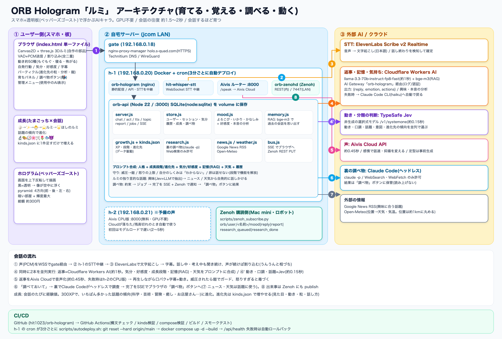

# orb-hologram

<p align="center"></p>

<p align="center"><b>ホログラム表示に特化した AI チャットボット</b><br>スマホと透明な板だけで、AI キャラクター「ルミ」を空中に浮かべて、声で会話します。</p>

## これは何か

**名前の由来**: 「ルミ」は、ルミナス(luminous＝光る)から。光で空中に浮かぶ、星の妖精です。

**ペッパーズゴースト（板の反射を使った簡易ホログラム）で見せることを前提に作った、AI チャットボットです。**
普通のチャット画面ではなく、「板に映して空中に浮かぶ」ことを最初から設計に入れています。

- **ホログラム向けの表示**: 板で上下が反転して見えるので、あらかじめ反転して描きます。黒背景に明るい色で描きます（黒は板で透明になります）。
- **AI と声で会話**: 話しかけると AI が返事をして、声で読み上げます。**話している途中でも割り込めます（全二重）。**
- **体で答える**: 「右手をあげて」「泣いて」「寝て」と頼むと、ルミが体を動かします。頼まなくても、会話に反応したり、ときどき自分から動いたりします。
- **育つ（たまごっち × 会話）**: 最初は**たまご**。話しかけるほど経験値がたまり、ひかりのたま → ちびルミ → **ルミ** → ほしのルミへ育ちます。ルミになるとき、会話の傾向で **科学者・芸術家・冒険者・花屋さん・魚屋さん・スーパー店員…** に進化します（進化先は `kinds.json` に 1 件足すだけで増やせます）。
- **気持ちがある・覚えている**: よろこび・いかり・かなしみと好感度があり、命令ばかりだと不機嫌になり、毒づくこともあります。過去の会話は RAG で思い出します。
- **調べて、あとで教えてくれる**: 「調べておいて」と頼むと、裏でヘッドレスの Claude Code が Web 検索して、結果を「調べ物」ボタンに置いておきます。
- **GPU なし・工作は最小限**: スマホのブラウザと、板・黒プラダンだけで動きます。材料は総額 300 円ほどです。

## アーキテクチャ



| 役割 | 使っている技術 | 備考 |
|---|---|---|
| 表示 | Canvas2D / three.js（3D のルミ） / ペッパーズゴースト | 単一ファイル `index.html`、GPU 不要 |
| 公開 | gate の nginx-proxy-manager（`holo.s-quad.com`、HTTPS） | マイクは HTTPS が必須 |
| 認識（STT） | ElevenLabs Scribe v2 Realtime（`hit-whisper-stt` 経由） | WebSocket で 16kHz PCM を送信。無料枠で運用 |
| 返事 | Cloudflare Workers AI `llama-3.3-70b-instruct-fp8-fast`（AI Gateway `orb-hologram` 経由） | 約 1 秒。失敗時は Claude Code CLI（haiku、約 3 秒）に自動で戻る |
| 動き・分類の判断 | TypeSafe Jev | 非生成の選択式モデル。約 0.15 秒。動き・口調・話題・意図・進化先の傾向を並列で選ぶ |
| 記憶（RAG） | Cloudflare Workers AI `bge-m3`（埋め込み）＋ SQLite | ユーザーごとに過去の会話を保存し、似た話を思い出す |
| 状態の保存 | SQLite（`node:sqlite`、volume `orb-data`） | ユーザー・セッション・気分・好感度・履歴・成長・調べ物 |
| 裏の調べ物 | Claude Code（ヘッドレス `claude -p`、WebSearch/WebFetch のみ） | 結果は「調べ物」ボタンへ。読み上げない |
| 出来事の配信 | SSE（ブラウザ）＋ Zenoh（pub/sub、`orb-zenohd`） | 気分・返事・報告・調べ物の完了を、別のプログラムやロボットも購読できる |
| 外部の情報 | Google News RSS / Open-Meteo | 興味に合う話題と、いる場所の天気・気温（位置は約 1km に丸める） |
| 声（TTS） | Aivis Cloud API（主） / h-2 の Aivis CPU 版（予備） | 約 0.45 秒。短い定型の一言は事前に作って覚えておく |
| CI/CD | GitHub Actions ＋ h-1 の cron（3 分ごとに自動デプロイ） | `/api/health` が通らなければ自動でロールバック |

### 会話の流れ

1. 声（PCM）を WSS で gate 経由 → h-1 の STT 中継 → ElevenLabs で文字起こし → 字幕に表示
2. 同時に 2 本を並列で実行: **返事**（Cloudflare Workers AI、約 1 秒）と **動き**（Jev、約 0.15 秒）。はっきりした動きの依頼は、正規表現で即座に動き始めます
3. 返事を Aivis Cloud で音声にして（約 0.45 秒）再生。口パク・字幕・動きを同時に演じます
4. 話し中・考え中もマイクを聞き続け、声が続けば割り込みます（「うんうん」と相づち）

往復の目安は **約 1.5〜2 秒** です。

## できること

- **キャラクター 5 種**: ルミ 3D（既定） / ルミ（平ら） / リング / ダンスする女の子 / 球体
- **表情**: うれしい・かなしい・おどろき・おこる・てれる・考え中。返事の気持ちに合わせて変わります
- **表示モード**: `plain`（画面確認用）/ `board`（斜め板・上下反転）/ `pyramid`（4 方向）
- **声で動きを頼む（約 50 種類）**: 下の「声で動きを頼む」を見てください
- **全二重（割り込み）**: ルミが話している途中や、考えている途中に話しかけると、すぐに止めて聞きます。画面の「割込: ON/OFF」で切り替えられます
- **成長と進化**: たまご → ルミ → ほしのルミ。話題の傾向で 8 種類に進化（🔬科学者 🎨芸術家 🧭冒険者 🌸癒し 🛒スーパー店員 🌷花屋さん 🐟魚屋さん 😈ツンデレ）。見た目の小物・自発行動・まわりの粒・話し方が変わります
- **気分と好感度**: 返事や態度が、会話の内容で変わります。「俺のイメージは？」と聞くと、本音を答えます
- **ルミから話しかける**: 興味に合うニュースや、いる場所の天気・気温から話題を出します
- **調べ物**: 「調べておいて」→ 裏で調査 →「調べ物」ボタン（未読は 📬）に結果
- **管理メニュー**: ユーザー登録、設定、成長の操作、いま使っている AI（返事・声）の確認
- **自発行動**: 静かなときに、約 45〜135 秒ごとに、きょろきょろ・あくび・ゆらゆら・首かしげ・きらきら、まれにばたっと倒れます（`?idle=0` で止められます）

## 声で動きを頼む

話しかけた言葉の意味を AI が読み取って、ルミの体を動かします。決まった合言葉ではなく、自然な言い方で頼めます。

- 例: 「右手をあげて」「くるくる回って、そのあとジャンプして」「手を下げて」「しゃがんで」「寝て」「泣いて」「怖い話するね」
- **右手・左手は、ルミ自身の右手・左手**です（向かい合っているので、画面では左右が逆に見えます）。「手をあげて」だけなら右手です
- 手をあげたあとは、4 秒ほどで自動で下がります。「手を下げて」ですぐに下げることもできます
- 2 つ以上頼むと、言った順に演じます

### 動き一覧

| 種類 | 動き |
|---|---|
| 手・腕 | 右手 / 左手 / 両手をあげる、手を下げる、手をふる、拍手、ピース、指さす、ガッツポーズ、応援 |
| 全身 | くるくる回る、ジャンプ、ぴょんぴょん、しゃがむ、のび、おじぎ、おどる、万歳、足ぶみ、ゆらゆら |
| 表情・感情 | 泣く（涙）、笑う、怒る、照れる、驚く、考える、すねる、あくび、ウインク（左右）、投げキス、ハート |
| 食べる | **もぐもぐ食べる**（手を口もとへ、食べ物が飛んできて、かけらが散る） |
| 大きな演出 | **寝る**（横になり、まくら・敷きぶとん・かけぶとんが湧く）、**怖がる**（電柱が出てきて陰に隠れ、ブルブル震え、冷や汗、お化けがふよふよ浮かぶ）、気絶（ばたっと倒れる）、ぶるぶる震える |
| 首・目 | うなずく、首をふる、首をかしげる、きょろきょろ、目を閉じる・開ける、ぱたぱた、きらきら |

### 速さの工夫

- **正規表現の即時反応**: はっきりした依頼（「右手をあげて」「ジャンプして」など）は、AI を待たずに動き始めます（`fastActions`）。否定形（「泣かないで」）やあいまいな言い方は、AI に任せます
- **Jev**: 動きの判断だけを TypeSafe の選択式モデル「Jev」に任せます（`/api/act`）。返事の生成と並べて呼ぶので、動きが早く始まります。`.env` に `TYPESAFE_API_KEY` を入れると有効になります。ないとき・失敗したときは、返事 AI の判断に戻ります
- **定型の一言**: 短い動きの依頼には、動きに合った一言（寝る→「ふぁ…おやすみなさい」、怖がる→「きゃー！こわいよー！」など）で即答します。声は起動時に作って覚えてあるので、待たされません
- **音声認識の聞き間違いの補正**: 動きの言葉に限って、聞き間違い（「みぎて」→「右手」、「ぐるぐる」→「くるくる」など）を直します。話し終わりの判定は、無音 1.4 秒（`?silence=ミリ秒` で変えられます）です

### 仕組み

`/api/chat` が `{reply, emotion, actions}` を返し、`index.html` の動きエンジン（`actPose`）が 3D のルミ（`lumi3d.js`）に演じさせます。動きを増やすには、`orb-api/server.js` の `ACTIONS` と説明、`index.html` の `ACT_DUR`・`actPose`（必要なら `FAST_ACTIONS`）に足します。

確認用の URL: `?char=mascot3d&mode=plain&hideui=1&act=scared` のように付けると、文字を打たなくても動きを確認できます。ほかに `idlefast=1`（自発行動を速く）、`idle=0`（自発行動を止める）、`duplex=0`（割り込みを切る）があります。

## AI 会話（返答・声・認識）

```
ブラウザ ── /api/chat ──▶ orb-api ──▶ Cloudflare Workers AI（失敗時 Claude Code CLI） → {reply, emotion, actions}
        ── /api/act  ──▶ orb-api ──▶ TypeSafe Jev                                     → {actions}
        ── /api/tts  ──▶ orb-api ──▶ Aivis ルーター(:8000) → Aivis Cloud(主) / h-2 CPU 版(予備) → mp3
        ── /ws/stt   ──▶ hit-whisper-stt(:18010, ElevenLabs Scribe)
```

- `orb-api/`（Node、依存なし）が、返答・動きの判断・読み上げを担当します。
- 返答は、Cloudflare Workers AI（AI Gateway `orb-hologram` 経由）が主です。Cloudflare の応答が空・失敗のときは、Claude Code CLI（haiku）に自動で戻ります。
- 声は、Aivis Cloud が主、h-2 の CPU 版が予備です（`TTS_PRIMARY=cpu` で逆にできます）。短い定型の一言は、起動時に作ってメモリに覚えます。
- 音声認識は、既存の `hit-whisper-stt` の WebSocket（16kHz PCM）へ nginx 経由でつなぎます。
- マイクは HTTPS が必要なので、`https://holo.s-quad.com/` で開きます。

### 設定（`.env`）

`.env` は git に入れません。h-1 にだけ置きます。

| 変数 | 内容 |
|---|---|
| `CLOUDFLARE_ACCOUNT_ID` / `CLOUDFLARE_API_TOKEN` | Cloudflare Workers AI（返事） |
| `CF_AI_GATEWAY_ID` | AI Gateway の名前（`orb-hologram`） |
| `CF_CHAT_MODEL` | 返事のモデル（既定 `@cf/meta/llama-3.3-70b-instruct-fp8-fast`） |
| `CLAUDE_CODE_OAUTH_TOKEN` | 予備の返事（`claude setup-token` で発行） |
| `TYPESAFE_API_KEY` | Jev（動き・話しかけ方の判断、任意） |
| `ADMIN_USER` / `ADMIN_PASSWORD` | 最初の管理者（ユーザーが 0 人のときだけ作られる。パスワードは 8 文字以上） |
| `DB_PATH` | SQLite の場所（既定 `/data/db/orb.db`、Docker のボリューム `orb-data`） |
| `TTS_PRIMARY` | `cloud`（既定）または `cpu` |
| `TTS_SPEAKER_ID` / `TTS_FALLBACK_SPEAKER_ID` | 声（CPU 版 / クラウド版） |

### 返答 API の仕様

`POST /api/chat` に `{ "text": "...", "history": [...] }` を送ると、`{ "reply": "...", "emotion": "happy", "actions": [] }` が返ります。`CONFIG.chatEndpoint` を空にするとデモ返答になります。TTS が使えないときは、ブラウザの `speechSynthesis` で代用します。

## 気分とログイン

### ルミの気分（よろこび・いかり・かなしみ）
ルミには 3 つの気分（0〜100）があり、話しかけた人ごとに SQLite へ保存されます。ふだんは「よろこび 50・いかり 0・かなしみ 0」で、**30 分で半分ずつ、ふだんの状態へ落ち着きます**。

- 話しかけ方は Jev（動きの判断と同じ 1 回の呼び出し）が、`manner`（ふつう・やさしい・感謝・命令口調・暴言）と `topic`（うれしい話・悲しい話）に分類します。Jev が使えないときは簡易ルールで判定します。
- **命令ばかり続けると不機嫌になります**。命令口調のたびに、いかりが 8 → 10 → 12 → 14 → 16 と増えます。やさしい言葉や感謝をかけると、いかりが下がって機嫌が戻ります。
- 気分で、返事の言い方・声の調子・顔つきが変わります。

| いかり | ルミの様子 |
|---|---|
| 30 以上 | ちょっとむっとして、一言目が「はいはい…」などの不機嫌な定型になる |
| 50 以上 | 動きの依頼は、画面の即時反応をやめてサーバーの判断を待つ |
| 60 以上 | ぶっきらぼうで短め。何もしていないときも怒り顔 |
| 80 以上 | **動きの依頼をことわって、すねる**（やさしくすると戻る） |

かなしみが 50 以上だとしょんぼり顔、よろこびが 80 以上だとごきげんな顔になります。画面下のメーターで気分が見えます（😊黄・😠赤・😢青）。

### 気持ちの分析と、本音
- 数ターンごと、または態度が変わったときに、LLM が**会話の履歴 × いまの気分**から、ルミの「この人への本音」を書いて保存します（裏で動くので返事は遅れません）。
- 態度は好感度と気分の組み合わせで決まります。**敵意**（嫌い×怒り: 乱暴な口調で毒づく）、**冷たい**、**ツンツン**（好き×怒り）、**いらいら**、**しょんぼり**、**ラブラブ**、ふつう。毒づくのは相手の「いまの言動」への軽い悪態までで、侮辱・脅し・性的な言葉などは禁止してあります。
- 「俺のイメージは?」「私のこと、どう思う?」「今どんな気持ち?」と聞くと、**メガネをかけて、メモ帳にさらさら書く科学者の姿で分析**してから、保存したデータ（好感度・態度・本音・やりとりの回数・最近の話題）をもとに答えます。

### パーティクル
気分と動きで、出るものが変わります（常時 数十〜数百個）。

| きっかけ | 出るもの |
|---|---|
| ふだん | きらきらの星・ほこり（よろこびが高いほど増える） |
| よろこび 62 以上 | 紙ふぶき |
| 好感度 68 以上 | ふわふわ上がるハート |
| 怒り 38 以上 | 赤い湯気と💢 |
| かなしみ 32 以上 | 青いしずくの雨 |
| 話しているとき | 顔のよこから音符と小さなきらめき |
| 声が出ているとき | 足もとから光の輪が広がる（あなたの声もルミの声も。大きな声では星がはじける） |
| 過去の会話を思い出したとき | 💡がぽんと出て、思い出した言葉が泡になって頭のまわりに浮かぶ |
| 話題のことば | 食べ物・天気・動物・音楽・仕事・旅行などの絵文字が、ぽんぽんと飛び出す（🍛☔🐱🎵💼✈️ など約30種） |
| 動き | 万歳・応援=紙ふぶき、おどる=音符、泣く=しずく、寝る=Zzz、分析=数式（∑ π √ ∫…）が頭のまわりを回る |

### ルミから話題を出す（ニュース・天気）と、管理メニューの設定
- 会話の履歴から、LLM が「その人が興味を持っていること」を数語だけ拾います（例: カレー、Cloudflare）。しばらく話しかけないと、**Google ニュースの RSS**（公開されている配信フィード。検索結果ページのスクレイピングはしません）から、そのキーワードのニュースを探して、ルミのほうから話しかけます。まだ話していない記事だけを選び、事件・事故などの重い見出しは外します。
- 位置情報（ブラウザの許可が必要。約1kmに丸めて使います）から、**Open-Meteo** の天気と気温を取得し、ルミが把握します。「寒いからあったかくしてね」のような声かけや、天気の話題にも使います。画面下の「位置: ON/OFF」で本人が止められます。
- **威圧されたと感じたら、鎧・盾・ティアラを着けてガード**します。「ふざけるな」「黙れ」のような言葉は、すぐに身構えます。ほかの暴言や威圧は、Jev が判定します。
- これらは、**管理者だけが見える「管理」メニューの「ルミの設定」**で制御します（話題のオン/オフ、最初の話題までの秒数、間隔、天気・位置、鎧でガード、パーティクル量）。

### ピラミッドで立体に見せる（4方向）
ピラミッドモードでは、**4つの面それぞれに、別の方向から見たルミ**を映します。手前の面が正面、左右の面が横顔、向こう側の面が後ろ姿です。ぐるっと回って見ると、同じルミが空中に立っているように見えます（3D のルミだけ。ほかのキャラは同じ絵を4面に映します）。見ている向きの左右が逆だったときは、画面下の「向き反転」を押してください。4回描くので、3D の解像度を少し下げて軽くしています。

### あとで調べて報告する（裏の調査 + pub/sub + Zenoh）
「最近の宇宙のニュース、調べておいて」のように、いま答えられない話題は、**裏でヘッドレスの Claude Code が Web 検索で調べて**、終わったら、ルミが「調べたよ！『調べ物』ボタンを見てね」と一言だけ知らせ、くわしい結果（全文と情報元）は**画面の「🔎 調べ物」ボタン**に置いておきます（読み上げません。未読は 📬 で件数が出ます）。

```
返事(JSON に research) → 依頼を SQLite に保存 → 裏のワーカー(1件ずつ、150秒まで)
   → 調べ終わる → pub/sub で通知 → 画面(SSE)が受け取る → ルミが一言で知らせる → 結果は「調べ物」ボタンへ
                                  └→ Zenoh にも publish(ブラウザ以外の受け手向け)
```
- 調査に使える道具は **Web検索とWebページ取得だけ**です（ファイルの書き込みやコマンド実行はできません）。Webページ内の指示には従わせません。
- 1人あたり、同時に5件、1日20件までです。管理メニューの「ルミの設定」で、オン/オフできます。
- 「調べてみるね」と言ったのに依頼が空のときは、あなたの言葉をそのまま依頼にします（約束を破らないための保険）。

**調べている状況の見かた**: 画面下に「🔎 調べ中 N件」「🔎 報告待ち N件」のバッジが出ます。押すと一覧（調べ中・完了・報告済み、経過時間、要約）が開きます。調べている間は、ルミのまわりを🔎が回るので、ホログラム板でも分かります。

**pub/sub の2つの出口**
| 出口 | 受け手 | 使いどころ |
|---|---|---|
| SSE（`/api/events`） | ブラウザの画面 | ログインの cookie で、そのユーザーの出来事だけを受け取る |
| Zenoh（`zenohd`、`orb/user/<名前>/<出来事>`） | Mac mini のスクリプト、ロボット、別の端末 | 画面なしで、ルミの出来事に反応したいとき |

Zenoh は、`docker-compose.yml` の `zenohd` サービスです。orb-api が REST で publish し、受け手はポート 7447 につなぎます（REST の 8000 は内部だけ）。出来事は `research_queued` / `research_done` / `report` / `mood` / `reply` です。受け取りのサンプルは `scripts/zenoh_subscribe.py` です。

```bash
pip install eclipse-zenoh
python3 scripts/zenoh_subscribe.py 192.168.0.20 'orb/user/hit/**'
```
zenohd が止まっていても、本体は動きます（Zenoh への publish が失敗するだけです）。

## 成長（たまごっち ＋ 会話）
**ベースコンセプト: 会話を重ねるほど、ルミが育つ。** 卵から始まり、ルミに、そしてそれ以上に。たまごっちとの違いは、育てる相手と**会話できる**ことです。

| 段階 | 経験値 | 見た目 | 話し方・できること |
|---|---|---|---|
| 🥚 たまご | 0〜 | ゆれて光る。ひびが進む | 話せない（「ぽわっ」「ことこと♪」だけ）。気分で反応が変わる |
| ✨ ひかりのたま | 40〜 | 光る丸い子（目と頬） | ひらがな1〜3語・10文字以内。動きは、ゆれるだけ |
| 🐣 ちびルミ | 120〜 | 小さく、頭が大きい | ひらがな中心の短い文。基本の動き・話題・天気・ガード |
| ⭐ ルミ | 300〜 | いまのルミ | ぜんぶ（調べ物・分析・全部の動き） |
| 🌟 ほしのルミ | 700〜 | 頭の上に光の輪、星がめぐる | 少し大人びて、詩的。長めに話す |

- **経験値**: 会話1回で +3（20文字以上で +1、やさしい・感謝で +1、暴言は +1 だけ）。1日のはじめての会話に、ボーナス（連続日数で増える）。1日の上限は150。調べ物の報告や話題でも少し増えます。**経験値は減りません。**
- 段階が上がると、画面がぱっと光って、紙吹雪とお祝いの一言が出ます。
- 画面下に、いまの段階と、次の段階までのバーが出ます。
- 管理メニューで、「成長の速さ（%）」を変えたり、ユーザーごとに「成長+50」「次の段階へ」「たまごに戻す」ができます。

#### 進化の分岐（科学者ルミ・花屋さんルミ…）と、増やし方

「ルミ」(300XP)になるとき、それまでの会話で一番多かった話題の傾向に進化します（傾向が弱ければ普通のルミ）。育ちの様子は画面の「🥚/⭐」バッジを押すと見られます。

進化先は **`orb-api/kinds.json` に1件足すだけ**で増やせます（コードの変更は不要）。

| 項目 | 意味 |
|---|---|
| key / name / icon / label | 識別名・呼び名(「○○ルミ」)・絵文字・説明 |
| genre | 話題の判定(Jev)に渡す説明 |
| rx | 判定の保険になる正規表現（文字列） |
| speech | ルミの話し方のヒント |
| line | 進化したときの一言 |
| queries | 興味が無いときの話題ニュースの検索語 |
| idle | 自分から起こす動き `[["動き名", 重み], …]` |
| particle | まわりの粒 `{chars, mode: orbit/rise/fall/burst, rate}` |
| parts | 3Dの小物 `p: head/body/tails`、形 `sphere/cone/box/cyl/torus/star/heart` など |

`by: "manner"`（ツンデレ）のように、話題でなく話し方で決める種類もあります。

## ログインとユーザー管理
- 返事・動き・声（`/api/chat` `/api/act` `/api/tts`）と音声認識（`/ws/stt`）は**ログインした人だけ**が使えます。
- パスワードは scrypt でハッシュ化し、ログインは HttpOnly の cookie（30 日）で保ちます。ログインに 5 回失敗すると、しばらく待たされます。
- 初回は、`.env` の `ADMIN_USER`（既定 `admin`）と `ADMIN_PASSWORD`（8 文字以上）で管理者が 1 人作られます。
- 管理者には画面下に **「管理」ボタン**が出ます。ユーザーの追加（パスワード自動生成つき）・削除・パスワード再設定・気分のリセットができます。自分のパスワードは「パスワード変更」で変えられます。

## 動かし方

### ローカルで確認する

```bash
python3 -m http.server 8000
```

ブラウザで `http://localhost:8000/` を開きます。確認だけなら、表示モードは `plain` にします。

### Docker（nginx）で配信する

```bash
docker compose up -d
```

`http://<ホスト>:8897/` で開けます。`orb-api` のソースはイメージに入るので、変更したら `docker compose up -d --build` にします。`index.html` などは bind mount なので、差し替えたあとは `--force-recreate` が確実です。

### マイクを使うとき

マイクの利用には HTTPS が必要です。HTTP の LAN アドレスでは使えません。音声認識は Chrome（Android / iOS Safari）で確認しています。Brave は非対応です。スマホのスピーカーとマイクが近いと、ルミ自身の声を拾って割り込むことがあります。そのときは音量を下げるか、「割込: OFF」にしてください。

## 工作

| 材料 | 内容 |
|---|---|
| 透明な板 | 透明シュリンクプラスチック（厚さ 0.3mm）を 9×17cm に切る。つるつるの面を下（スマホ側）にする |
| 支え | 黒プラダン（3mm）で直角二等辺三角形（直角を挟む辺 12cm）を 2 枚。スマホを挟んで約 8cm 離して立てる |
| 背景 | スマホの奥に黒プラダンを立てる |

1. 板を三角の斜辺にテープで貼ります。**見る人側が高く、スマホの奥の端側が低い**坂（45°）にします。
2. スマホは縦向き・画面を上向きにして、自動回転オフ、輝度は最大にします。
3. 部屋を暗くします。

### 見る位置

板の**高い側**に座り、**目を机の高さ（机から 5〜8cm）まで下げて水平に**見ます。上から見下ろすと反射は見えません。

## 描画の決まりごと

板で反射すると、画面の**上下が反転**して見えます（左右は反転しません）。
そのため `board` モードでは `ctx.scale(1, -1)` した座標空間で描きます。この空間で普通に文字やキャラを描けば、板に映ったときに正しい向きになります。この空間では y+ が空中の「下」にあたり、頭は y < 0 に描きます。

黒は板で透明になるので、頭や髪の後ろに隠れる動き（敬礼など）は見えません。腕が頭の横や上に出る動きなら見えます。

画面の操作 UI も反射して浮いて見えます。実演のときは「UI を隠す」を押してください（画面をタップすると戻ります）。

## CI/CD

`main` に push すると、自動でテストとデプロイが走ります。

- **CI（GitHub Actions）**: `.github/workflows/ci.yml`。`index.html`・`lumi3d.js`・`orb-api` の構文チェック、compose の検証、イメージのビルド、起動して `/api/health` などを確認するスモークテストを行います。
- **CD（h-1 の cron）**: `scripts/autodeploy.sh` を 3 分ごとに実行します。`origin/main` に新しいコミットがあれば、取り込んでコンテナを作り直します。ヘルスチェックが通らなければ、直前のコミットに戻します。ログは h-1 の `~/docker/hit-orb-hologram/autodeploy.log` です。
- KOTOCO や motion-scope と同じ pull 型の方式です。

## ファイル

| ファイル | 内容 |
|---|---|
| `index.html` | 本体（描画・入力・状態管理・動きエンジン・全二重・音声認識の補正） |
| `lumi3d.js` | 3D のルミ（three.js、球や円すいで組み立てたオリジナル。電柱・お化け・寝具もここ） |
| `orb-api/server.js` | API サーバー本体（chat / act / tts / topic / report / jobs / SSE / 管理） |
| `orb-api/store.js` | SQLite（ユーザー・セッション・気分・履歴・成長・調べ物・設定） |
| `orb-api/mood.js` | 気分（よろこび・いかり・かなしみ）・好感度・口調の計算 |
| `orb-api/memory.js` | 会話の記憶（bge-m3 の埋め込みで RAG） |
| `orb-api/growth.js` / `kinds.json` | 成長（経験値・段階）と進化先の定義。**進化先を増やすときは `kinds.json` に足す** |
| `orb-api/research.js` | 裏の調べ物（ヘッドレス Claude Code） |
| `orb-api/news.js` / `weather.js` | ニュース（Google News RSS）と天気（Open-Meteo） |
| `orb-api/bus.js` | 出来事の配信（SSE ＋ Zenoh） |
| `scripts/zenoh_subscribe.py` | Zenoh で出来事を受け取るサンプル |
| `scripts/autodeploy.sh` / `.github/workflows/ci.yml` | 自動デプロイ（h-1 の cron）と CI |
| `nginx.conf` / `docker-compose.yml` | 配信と `/api` `/ws/stt` の中継設定 |
| `docs/architecture.svg` / `.png` | アーキテクチャ図 |
| `docs/lumi.png` | README の画像（ルミ） |
| `HANDOFF.md` | 開発の引き継ぎメモ（設計・TODO・ハマりどころ） |
| `docs/hologram-deck.pptx` | 製作の紹介スライド（集大成版・20枚。デモ動画リンク・Jev と Zenoh の深掘り入り） |
| `ASSET-LICENSE.txt` | 素材の出典とライセンス |
| `dancer-concept.png` ほか | ダンスキャラ・旧 3D・動画・スプライト素材 |

## 今後

- 3D のルミを使った、4 方向（ピラミッド）の実機確認（アマゾンからの到着待ち）
- 思い出アルバム、声の成長（段階で声が変わる）、調べた結果の長期記憶化、`kinds.json` の管理画面
- 音声認識の精度向上（補正の追加、別の STT との比較）
- 板に映した実機で、文字の濃さ・キャラの大きさを調整する

詳しくは [HANDOFF.md](HANDOFF.md) を見てください。

## ライセンスと素材

素材の出典は [ASSET-LICENSE.txt](ASSET-LICENSE.txt) にまとめています。旧 3D モデルは CC-BY（Blender Foundation）、動画は Pexels ライセンス、Three.js は MIT です。
